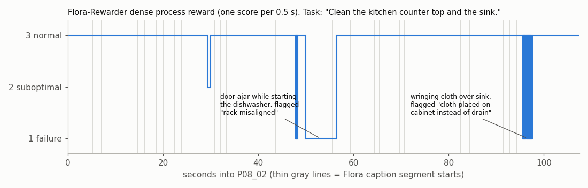

# 04 · Flora: open models for labeling egocentric video

**Date:** planned 2026-11-07, run 2026-11-08 · **Track:** Data labeling · **Status:** run at full precision on one A100 80 GB, results below · **Spend:** about $3.30 (1.10 h of one Spot `a2-ultragpu-1g` plus its disk), plus about $1.26 for the 2026-11-08 extension, which was stopped by Spot preemptions (see "More clips")

## Goal

Learn what NVIDIA's Flora models actually produce on ordinary egocentric household video, and what it takes
to run them. On one public 107 s kitchen clip, get (1) temporal segments, (2) timestamped action captions and
(3) a dense 0.5 s process reward plus a 1 to 5 outcome score, with all three models at the precision the authors
validated (BF16 weights, FP32 Gated-DeltaNet parameters). Then check whether the labels match what happens in
the clip, and how their granularity compares with FineART-style step labels ([experiment 01](../01-fineart-dataset/README.md)).

The original plan was a 24 GB L4 with the two 27B models in 4-bit. I ran the faithful fallback instead: one
A100 80 GB with `--mode reference`, i.e. the unmodified upstream commands, models loaded one at a time.

## Results (run on 2026-11-08)

### Headline

| Model | What it produced on P08_02 (107 s) | Wall time | Peak VRAM (nvidia-smi) |
|-|-|-|-|
| Flora-TempSeg (9B, LoRA on Qwen3.5-9B) | 40 segments from 15 overlapping 16 s windows | 7.7 min (11 s load, 161 s of generation, the rest video decoding) | 19.2 GiB (18.5 GiB allocated by PyTorch) |
| Flora-Captioner (27B) | 40 captions, all `complete` | 21.1 min (6.7 min SHA-256 check of 109 GB of shards, 2.5 min load, 11.8 min captioning of which 175 s is generation) | 64.1 GiB (59.9 GiB allocated) |
| Flora-Rewarder (27B), dense | a score every 0.5 s, 11 clips, 0 invalid | 5.6 min (vLLM load 21 s, `torch.compile` 51 s, warm-up 99 s, inference about 40 s) | 71.9 GiB (51.0 GiB weights, the rest is vLLM's KV-cache reservation at `--gpu-memory-utilization 0.88`) |
| Flora-Rewarder (27B), outcome | score 5, P(5) = 0.9999, progress 1.0 | 1.9 min (compile cache warm) | 70.1 GiB |

- The caption stage (TempSeg then Captioner, one process) took 29.4 min end to end. NVIDIA reports 23 min for a 107 s
  video on one H100, including downloads. The difference is mostly I/O and CPU, not the GPU (see "Problems and fixes").
- Annotation and reward never ran at the same time. Flora's annotation session frees TempSeg before it loads the
  Captioner, and the rewarder is a separate vLLM process, so one 80 GB GPU is enough for everything except the
  rubric reward (which defaults to two GPUs and was not run).
- Flora's own load-time checks passed: TempSeg adapter values and GDN parameters bit-exact and FP32, Captioner GDN
  parameters bit-exact and FP32, all parameters on the GPU.

### Quality read

I compared the outputs with the EPIC-KITCHENS ground-truth narrations for this video
([`results/epic_ground_truth_P08_02.json`](results/epic_ground_truth_P08_02.json), 34 narrations) and with frames
I pulled at the flagged times.

**Segments and captions: good.** The clip has three phases, and Flora recovers all three in order with roughly the
right boundaries:

| Phase (ground truth) | Ground-truth narrations | Flora captions (examples) |
|-|-|-|
| 0 to 31 s: load the dishwasher | "put plates on counter", "open dishwasher", "place fork", "arrange mug", "arrange glass", "arrange bowls in drawer" | `0.0-5.2 s` place plate on counter with both hands · `7.0-9.2 s` pick up knife and fork with right hand, place knife and fork in dishwasher with right hand · `23.9-27.3 s` pick up glass with left hand, place glass in dishwasher rack with left hand |
| 31 to 58 s: start the dishwasher | "close dishwasher", "open cupboard", "unwrap", "start dishwasher", "throw away wrap" | `39.6-43.6 s` open dishwasher door with right hand, unwrap soap with both hands · `43.6-45.2 s` place detergent in dishwasher with right hand, close detergent compartment with right hand · `55.6-59.4 s` place debris in trash can with left hand, pick up cloth with left hand |
| 58 to 107 s: clean counter and sink | "get sponge", "clean counter top" (71 to 82 s), "clean sink" (84 to 90 s), "squeeze sponge", "place sponge back", "wipe off hands" | `70.6-82.4 s` wipe counter with sponge in right hand · `84.4-89.8 s` wipe sink with sponge in right hand · `91.4-92.8 s` fold cloth with both hands, squeeze cloth with right hand |

- Timing is close: "clean counter top" 71.3 to 82.4 s in the ground truth vs Flora 70.6 to 82.4 s; "clean sink"
  84.4 to 89.9 s vs 84.4 to 89.8 s.
- Errors I could see:
  - **Object naming drifts.** The same blue sponge cloth is called "cloth" in some segments and "sponge" in others.
    At 69.8 to 82.4 s Flora emits two overlapping segments for the same action, one with "cloth" and one with "sponge".
  - **A missed action.** "Start dishwasher" (pressing the control panel, 48.5 to 54 s) becomes "hold debris with left
    hand, close dishwasher door with both hands" over a 10.4 s segment.
  - **Reasonable guesses at hidden objects.** The dishwasher tablet is "soap" and then "detergent". The towel hung on the
    oven handle after drying hands (ground truth "wipe off hands") is "place cloth on oven handle".
- 5 of 40 segments were marked `fine_repaired_by_fine_retry`, Flora's own re-segmentation of windows it was unsure about.
  4 of those are where the overlaps are.
- Frames with the caption burned in: [`results/frames/`](results/frames/).

**Outcome reward: right, and it discriminates.** For the task "Clean the kitchen counter top and the sink." the full
clip scored 5 with P(5) = 0.9999 and a correct rationale ("wiped the countertop and sink with a blue cloth, then rinsed
the cloth"). As a negative control I scored only the first 45 s (dishwasher loading, no cleaning) against the same task:
score 1, P(1) = 0.9994, progress 0.0002, and a rationale saying the counter and sink were not cleaned and the dishes
were loaded into the dishwasher instead. Both rationales say "the robot" about a human, because the prompts are
written for robots.

**Dense (process) reward: plausible-sounding, not reliable on this clip.** 92.4% of the 0.5 s steps are "normal",
7.1% "failure" and 0.5% "suboptimal" (mean 2.85 of 3). I checked the flagged spans against the video:

| Span | Rewarder says | What the frame shows |
|-|-|-|
| 29.4 to 29.9 s (2) | "left hand hit the white bowl in the dishwasher rack" | a plausible minor bump while arranging bowls |
| 47.9 to 56.4 s (1) | "the rack is misaligned with the cabinet opening" | the person is pressing the dishwasher's control panel with the door slightly open, i.e. starting it. A false positive |
| 95.6 to 97.4 s (1) | "the blue cloth is placed on the top of the cabinet instead of the sink drain" | the person is wringing the cloth over the sink. A false positive that alternates 1/3 every 0.25 s where overlapping clips are merged |



- One clip-level flag did not survive the merge: clip 1 said the plate "falls onto the bottom of the dishwasher" at
  12.6 to 13.6 s. The overlapping clip scored that span normal, and the merged output kept "normal".
- The first 30 s (loading the dishwasher, not part of the stated task) is scored "normal". The dense reward judges
  *how well* each motion is executed, not whether it serves the task. Task progress belongs to the outcome reward.
- My read: the dense reward's failure vocabulary ("misaligned", "placed instead of") comes from robot pick-and-place,
  and human household motions that look unusual to it get flagged. Treat it as a candidate list for human review,
  not as a label.

### Granularity: Flora captions vs FineART step labels

| | Flora on P08_02 | EPIC narrations (P08_02) | FineART subtask labels |
|-|-|-|-|
| Segment length | mean 3.2 s, median 2.1 s (1.0 to 12.6 s) | mean 2.8 s | about 9 s (5 to 15 s typical) |
| Segments per 107 s | 40 | 34 | about 12 at 9 s each |
| Text | imperative, median 11 words, 26 of 40 are 2 or 3 clauses joined by commas, every caption names the hand | 2 to 3 word verb-object | imperative, one action per label, median 8 words, attribute-rich object plus destination |
| Timeline | start and end per segment; segments may overlap (4 overlaps here) | start and end; overlaps allowed | start-only, contiguous, non-overlapping |

- Flora labels at the level of the atomic action (grasp, pass between hands, place), which is EPIC's level, not
  FineART's subtask level. A FineART-style step such as "Load the plates and cutlery into the dishwasher" would
  correspond to about 10 Flora segments.
- Getting FineART-style labels from Flora means post-processing: merge consecutive segments that share an object or
  goal into one step, write one imperative per merged span, drop the hand detail, resolve overlaps into one timeline,
  and fix object names. The per-hand detail Flora adds is something FineART does not have, and it is useful for
  bimanual robot data.

### What this teaches about labeling egocentric video

1. **Open models can now do a credible first pass on segments and captions.** On this clip the phase structure, the
   order and most boundaries matched human narrations to within about a second, at full precision on one 80 GB GPU.
   The errors are the kind a reviewer fixes quickly: inconsistent object names, overlapping duplicates, one merged action.
2. **Pick the label grain on purpose.** Flora's grain (about 3 s, per hand) is finer than the 5 to 15 s step labels
   used to train step-following policies. Both are useful, but they are different products, and converting between
   them is a deliberate merge step.
3. **Outcome scoring is more trustworthy than dense scoring.** The episode-level score separated success from a
   negative control with near-certain probabilities and correct rationales. The 0.5 s failure flags on human video
   were mostly false positives. Use dense scores to prioritize review, not to filter data automatically.
4. **Always run a negative control.** A score of 5 alone does not tell you the scorer can say no. Truncating the clip
   to a part where the task was not done took two minutes and showed that it can.
5. **The bottleneck is I/O and CPU, not the GPU.** About 60% of the annotation wall time was hashing 109 GB of FP32
   shards, reading them from a pd-balanced disk, and single-threaded PNG encoding of frames. For volume work, the
   disk type, a warm page cache and a long-running process that keeps the model loaded matter more than the GPU.
6. **License limits use.** Everything here is research/evaluation only under the NVIDIA License (below). Labels made
   with Flora cannot go into a commercial product or a dataset sold to others without a separate license from NVIDIA.

## More clips (2026-11-08)

**Status: not run on the GPU.** The plan was 4 more household-task clips and one negative control on one Spot
A100 80 GB. All three Spot VMs were preempted during setup, before any model ran, so there are no new Flora outputs.
The clip set, the ground truth, the batch mode in `run.py` and the merge-to-steps script are ready for a re-run.
The merge script was evaluated on the existing P08_02 output instead.

### What happened

| Try | Zone | Up (UTC, 2026-11-09) | Reached | End |
|-|-|-|-|-|
| 1 | us-central1-a | 02:00:12 to 02:08:43 (8.5 min) | clip downloads 70% done, weights 37 GB of 185 GB | preempted |
| 2 | us-central1-c | 02:11:39 to 02:25:35 (13.9 min) | setup, downloads and weight prefetch in progress | preempted |
| 3 | us-central1-a | 02:28:28 to 02:31:13 (2.8 min) | setup just started | preempted |

- The VM tool sets `--instance-termination-action=DELETE`, so each preemption deleted the VM and its disk, and
  setup (about 20 min) had to start over each time.
- `a2-ultragpu-1g` does not exist in us-central1-b or us-central1-f ("Machine type ... does not exist in zone"),
  so a and c were the only zones to try. Spot A100 80 GB quota exists only in us-central1.
- I stopped after the third preemption: about 25 min of VM time had gone to this one blocker, and three
  preemptions in 30 min made an uninterrupted 2 h run unlikely that night.
- **Takeaway:** for Spot runs longer than about an hour, build the environment once on a disk that survives
  preemption (`--instance-termination-action=STOP`, or a separate data disk or image with the venvs and weights),
  or run at a quieter hour. The previous run got 1.1 h without a preemption in the same zone.

### Clips chosen (inputs ready, not run)

I picked them from the EPIC-100 narration annotations: short videos (60 to 120 s, because Flora's annotation input
limit is 120 s) or 110 s windows with the highest share of the target verbs. Each clip is from a different
participant, none from P08. Manifest: [`more_clips.json`](more_clips.json). Ground-truth narrations (CC BY-NC 4.0)
are in `results/more_clips/epic_ground_truth_<clip>.json`, with times on the clip's own clock.

| Clip | Kind | Length | Source | EPIC narrations (mean length) | Outcome task |
|-|-|-|-|-|-|
| P14_07 | dishwashing | 90.3 s, whole video | `train/P14`, 340 MB | 12 (5.2 s): take sponge, open tap, wash spoon (16 s), wash bowl (30 s), turn off water | Wash the spoon and the bowl in the sink. |
| P01_19, 301 to 416 s | wiping | 115 s window | `train/P01`, 1.8 GB video; ffmpeg reads only the window over HTTPS (the server accepts byte ranges) | 31 (4.5 s): rinse and squeeze cloth, wipe sink, wipe counter, wipe cooker (30 s), wash sink | Wipe the sink, the counter and the cooker with the cloth. |
| P28_24 | food prep | 68.3 s, whole video | `test/P28`, 258 MB | 16 (5.1 s): cut tomato, throw piece in bin, chop tomato, take dish from microwave, chop tomato | Chop the tomato. |
| P11_24 | put-away | 83.6 s, whole video | `test/P11`, 315 MB | 24 (2.4 s): put away wine glass, bowls, chopping block, mug and scissors in cupboards, put bag in bin | Put the dishes away in the cupboards. |
| P14_07, first 46 s | negative control | 46 s | cut from the P14_07 re-encode | spoon washed, bowl not yet picked up (EPIC: pick up bowl at 46.5 s) | same task as P14_07; expected well below 5 |

All URLs are under `https://data.bris.ac.uk/datasets/3h91syskeag572hl6tvuovwv4d/videos/`, the same direct route as
P08_02 (some are in `test/`, not `train/`). Downloads ran at about 1.1 MB/s per stream, so `run.py` fetches in parallel.

### What is ready for the re-run

- `run.py --clips more_clips.json` runs `fetch`, `caption` and `reward` for all clips, one Flora process per stage:
  - the annotation CLI's `--input-jsonl` for the captions;
  - the rewarder's `--jobs` for dense and outcome rewards (the outcome jobs include the negative control);
  - log lines stamped with UTC time, so runtime and peak VRAM can be split per clip from the logs and the GPU trace.
- **Skipping the re-hash:** this needs no change to Flora. Inside one process, Flora remembers which model manifests it
  has already SHA-256-checked, keyed on each file's path, inode, size, mtime and ctime
  (`captioner/batch_utils/models.py`, event `manifest_verified_reuse`). It re-hashes if any file changed. So
  `--input-jsonl` should pay the 6.7 min Captioner hash once for all clips, not once per clip. I read this in the
  code; it has not been measured.
- `PYTHONUNBUFFERED=1` in the child environment fixes the late log lines from the first run.
- `--clips` reached clip downloads on the VM and nothing further. The caption and reward batch paths have not run yet.

### Merge to steps (`merge_steps.py`, CPU)

The rule, with thresholds fixed before looking at results:

1. **One timeline.** A segment that starts inside the previous one is trimmed to start where the previous one
   ends. A segment almost fully inside the previous one is folded into it.
2. **Verb and object per clause.** Each Flora caption is split at commas, the hand phrases are dropped, and the
   verb and object are read from each clause. For example, "pick up glass with left hand" gives (pick up, glass).
3. **Greedy merge.** The next segment joins the current step when three things hold:
   - it is adjacent (gap of 1 s or less);
   - the step stays 15 s or shorter;
   - the two share a verb-object pair, or the object, or enough caption words (Jaccard 0.3 or more).
4. **Short steps.** A step shorter than 4 s joins the neighbour it shares more words with.
5. **Output.** Each step gets one imperative, taken from the clause about the step's main object. Steps are written
   as FineART-style rows: `style: subtask`, a start `timestamp`, and `content`; contiguous, non-overlapping and start-only.

Scoring against the EPIC narrations:

- **Boundary error:** the distance from each internal step boundary to the nearest EPIC narration start or end.
  EPIC boundaries are dense (one every 1.5 s or so), so I also report evenly spaced boundaries as a chance baseline.
- **Matched human steps:** an EPIC narration counts as matched when one step covers at least half of it and mentions
  its verb or noun (a small synonym table maps tap to faucet, cupboard to cabinet, and so on). "Strict" counts only
  the step's one-line text. "Lenient" also counts the Flora captions merged into the step.

Result on P08_02 (the only clip with Flora output), from [`results/more_clips/steps_P08_02.json`](results/more_clips/steps_P08_02.json):

| | Units | Mean length | Boundary error, median (even-grid baseline) | Boundaries within 1 s of a human one | EPIC narrations matched, strict / lenient |
|-|-|-|-|-|-|
| Raw Flora segments | 40 | 3.2 s | 0.27 s (0.56 s) | 82% | 26 / 26 of 34 |
| Merged steps | 10 | 10.7 s | 0.22 s (0.71 s) | 100% (9 of 9) | 11 / 30 of 34 |

- **Length is on target.** The 10 steps run 5.2 to 14.4 s, mean 10.7 s, which is in FineART's 5 to 15 s range.
  That is about 4 Flora segments per step.
- **Boundaries are good.** Every merged boundary falls within 1 s of a human boundary, and the median error is a
  third of the chance baseline. Two of them, 30.8 s and 59.4 s, fall close to the clip's two phase changes
  (about 31 s and 58 s in the ground truth).
- **Step text is the weak part.** One line per 11 s step names only 11 of the 34 human actions (strict). The merged
  captions still cover 30 of 34 (lenient), so the information is there but the summary drops it. Several step
  texts name a sub-action, not the goal:
  - "Pick up plate." for 5 to 16 s, where the person is loading cutlery and plates into the dishwasher;
  - "Hold debris." for 45 to 59 s, where the person starts the dishwasher and throws away the wrap;
  - "Pass cloth." for 59 to 71 s, where the person gets the sponge and turns on the tap.

  A rule cannot write goal-level text such as "Load the plates and cutlery into the dishwasher". That needs a
  language model over the merged captions, or a human.
- This is one clip, so these numbers are a first check, not a measured accuracy.

### Per-clip results, negative control

Not available: no model ran on the new clips. The P08_02 results and conclusions above still stand, and nothing
in this attempt changes them.

### Cost

| Item | Used | Cost |
|-|-|-|
| `a2-ultragpu-1g` Spot at $2.952/h (rate from the first run) | 25.2 min over 3 VMs (8.5 + 13.9 + 2.8) | about $1.24 |
| 300 GB pd-balanced disks | the same 25 min | about $0.02 |
| **Total** | 0.42 VM-hours of the 4 h cap | **about $1.26** |

After the third preemption I ran `gcloud compute instances delete scout-flora2-a100 --zone us-central1-a --quiet`
(it reported "not found", because the preemption had already deleted the VM). `gcloud compute instances list` and
`gcloud compute disks list` both returned "Listed 0 items".

## Steps actually run

```bash
# laptop (Git Bash): one Spot A100 80 GB, hard-deleted after 3 h by GCE, 300 GB pd-balanced boot disk
PROJECT=<project> NAME=scout-flora-a100 MACHINE=a2-ultragpu-1g SPOT=1 HOURS=3 DISK_GB=300 ZONE=us-central1-a \
  bash ../../tools/gpu-vm/create_vm.sh            # us-central1-a had Spot capacity on the first try
gcloud compute scp setup.sh run.py scout-flora-a100:flora-lab/ --zone us-central1-a

# VM (Ubuntu 24.04.5, Python 3.12.3, driver 580.178.04, ready about 30 s after create)
WITH_BNB=0 bash setup.sh                          # no bitsandbytes on 80 GB; about 18 min, mostly the vLLM venv
export FLORA_LICENSE_ACK=noncommercial-research-eval
python3 run.py prefetch --mode reference          # new: all weights up front, same revisions (15 min, 185 GB)
python3 run.py fetch    --mode reference          # in parallel: clip download (about 6 min) + 720p re-encode (98 s)
python3 run.py validate --mode reference          # --validate-only and --dry-run both passed
python3 run.py caption  --mode reference          # TempSeg -> Captioner, unmodified upstream CLI
python3 run.py reward   --mode reference          # dense + outcome, unmodified upstream CLI
python3 run.py summary  --mode reference
# extra: outcome reward on the first 45 s only (negative control), same model, same task text

# laptop: copy back small results, then
gcloud compute instances delete scout-flora-a100 --zone us-central1-a --quiet   # and confirm no instances or disks remain
```

Setup, prefetch and fetch ran in parallel and were all done 21 min after the VM was created.

Changes to the scripts for this run:

- `setup.sh`: `WITH_BNB=0` skips bitsandbytes (only needed for the 4-bit L4 path).
- `run.py`: sets `VLLM_USE_FLASHINFER_SAMPLER=0` (lesson from experiment 05); adds a `prefetch` stage so model
  timings exclude downloads; writes a time-stamped GPU-memory trace (`*.gpu.csv`) next to each log, so peak VRAM
  can be split per model.

### Pinned versions

- Flora `d8b755ec9a990418b1f31c7f48c75341c7229ea6`.
- Models: TempSeg `114a1076…`, Captioner `fef0bbfe…`, Qwen3.5-9B base `c2022362…` (all from Flora's `models.json`);
  Rewarder `b64cee90…`.
- Annotation venv: torch 2.11.0+cu128, torchvision 0.26.0+cu128, transformers 5.22.1.
- Rewarder venv: vLLM 0.33.0, which pulled torch 2.14.0+cu130, transformers 5.20.2.
- Full lists: [`results/freeze-annotation.txt`](results/freeze-annotation.txt), [`results/freeze-rewarder.txt`](results/freeze-rewarder.txt).
- Image family `common-cu129-ubuntu-2404-nvidia-580` (Deep Learning VM). I did not record the dated image name.

### Problems and fixes

| Problem | Cause | Fix / note |
|-|-|-|
| `gcloud compute scp` failed with `~/flora-lab/: not a directory`, then "Multiple remote sources not supported" | Windows gcloud uses PuTTY's `pscp`, which does not expand `~` or accept several remote files | Use paths relative to the home directory, and tar the results on the VM so one file is copied back |
| Captioner stage spent 6.7 min before loading anything | Flora SHA-256-verifies all 109 GB of Captioner shards (stored in FP32) on every load; pd-balanced read about 270 MB/s | Expected behaviour. A pd-ssd disk (the original plan) or a local SSD would cut this; a long-running process would pay it once |
| 11.8 min to caption 40 segments with only 175 s of GPU generation | `pipeline.py` writes every input frame to PNG on one CPU core (seen with `py-spy dump`) | None for this run. It is upstream behaviour |
| Logs looked stalled while the model was working | `run.py` tees child output into block-buffered files | Watched the GPU trace instead; harmless |
| vLLM logged 96 "Attempted to load weight … float32 into parameter with dtype bfloat16" warnings for `linear_attn.dt_bias` / `norm.weight` | vLLM 0.33.0 keeps these Qwen3.5 GDN parameters in BF16, while the annotation path keeps them in FP32 | Upstream behaviour, not changed. A small precision difference between the two paths to keep in mind |
| "FlashInfer kernels are disabled" warning | no `nvcc`/`ninja` for JIT | Harmless with `VLLM_USE_FLASHINFER_SAMPLER=0` |

Nothing asked for a Hugging Face token: all four repos reported `gated: false` and downloaded anonymously.

## Cost

| Item | Rate (Google Cloud Billing Catalog, us-central1, effective 2026-11-08) | Used | Cost |
|-|-|-|-|
| `a2-ultragpu-1g` Spot: 12 vCPU × $0.01712 + 170 GB RAM × $0.002294 + A100 80GB GPU $2.3568 | **$2.952/h** (on-demand would be about $5.03/h) | 1.10 h (created 19:58:57Z, deleted 21:04:45Z) | $3.24 |
| 300 GB pd-balanced boot disk | $0.10/GB-month | 1.10 h | $0.05 |
| Ingress (185 GB from Hugging Face, 405 MB from data.bris) | free | | $0 |
| **Total** | | | **about $3.30** |

The pricing pages on cloud.google.com render their tables client-side and could not be read as text, so the rates
come from Google's Cloud Billing Catalog API (Compute Engine SKUs), the source behind those pages. The VM and its
disk were deleted at the end; `gcloud compute instances list` and `gcloud compute disks list` both returned nothing.

Time split of the 1.10 VM-hours: setup and downloads 21 min, annotation 29 min, rewards 8 min, negative control
2 min, the rest checks and copying.

## What Flora is

- A three-model suite from NVIDIA GEAR that turns robot and human manipulation video into labels: when
  each action happens, what it is, and how well it went. Announced 2026-10-20; NVIDIA says it is the data
  engine used to train GR00T-2.
- Project page: <https://research.nvidia.com/labs/gear/flora/> · paper: arXiv:2610.31779 ·
  code: <https://github.com/NVlabs/Flora> (the README's clone line says `NVIDIA/Flora`; both resolve to the same
  commit) · weights: <https://huggingface.co/collections/nvidia/flora>
- The repo is inference code only ("sample vanilla inference code"). No training code.

### The three models

| Model (HF repo) | Params | Base | Download | Measured peak VRAM on A100 (this run) | Fits one 24 GB L4? |
|-|-|-|-|-|-|
| Flora-TempSeg / "Flora-segmenter-9B" (`nvidia/Flora-TempSeg`) | 9.0 B (LoRA r=32 on the base) | Qwen3.5-9B (Apache-2.0) | 0.4 GB adapter + 19.3 GB base | 19.2 GiB | **Probably** at release precision (not tested on an L4) |
| Flora-Captioner / "Flora-captioner-27B" (`nvidia/Flora-Captioner`) | 27.4 B (full fine-tune) | Qwen3.5-27B | 109 GB (shards stored in FP32) | 64.1 GiB | **No.** Only as an unvalidated 4-bit experiment |
| Flora-Rewarder / "Flora-rewarder-27B" (`nvidia/Flora-Rewarder`) | 27.8 B (full fine-tune incl. vision) | Qwen3.5-27B | 55.6 GB (BF16) | 51.0 GiB weights, 72 GiB with vLLM's KV-cache reservation | **No.** Only as an unvalidated 4-bit experiment |

- The validated setup is Linux x86_64, Python 3.12 and one **H100 80 GB**. This run shows one **A100 80 GB** also
  works for annotation, dense and outcome rewards. The rubric reward needs **two** 80 GB GPUs by default
  (`--tensor-parallel-size 2`).
- The Captioner loader caps each GPU at (VRAM minus 12 GiB) and then refuses to run if any module would land
  off-GPU. On an A100 80 GB that cap is 68 GiB, enough for the 51 GiB of BF16 weights.
- Precision matters to the authors: BF16 weights with FP32 Gated-DeltaNet (`A_log`, `dt_bias`) parameters,
  verified bit-exact at load time. Their `AGENTS.md` says not to change prompts, frame sampling or
  precision, because other values "give worse results without any error".
- Reported throughput: a 107 s video took 23 minutes on one H100, first run including downloads. At scale they
  quote about $0.72 per hour of video (eight GB300s at $10 per GPU-hour).

### Inputs

- **Annotation (TempSeg then Captioner):** one MP4 per job: 120 s or less, 256 MiB or less, 4096 px or less per side,
  at least 4 FPS, one video stream. Profiles: `human` (one egocentric camera), `yam` (parallel grippers),
  `dex`, `tianji`. Robot profiles take up to three synchronized cameras. TempSeg reads overlapping 16 s windows
  at 4 FPS (64 frames; 32 s with `--yam32`). The Captioner sees a target interval plus BEFORE/AFTER context
  (8 FPS, at most 40 frames). Pass native video. Do not resample.
- **Rewarder:** outcome uses at most 64 frames of the episode. Dense uses 16 s clips of 64 frames at 4 FPS, one
  every 10 s. Rubric uses each camera at 2 FPS, at most 166 frames. Up to 4 camera views are tiled into a collage.
  A `--task` instruction in plain English is required.

### Outputs

- **Annotation:** one JSON per video (`schema_version: flora_demo_annotation_v1`). `segments[]` holds
  `{start_s, end_s, caption, status, segmentation_provenance}` in seconds. Segments may overlap.
  `caption` is one English imperative instruction, filled only when `status` is `complete`.
- **Outcome reward:** `score` 1 to 5, `probabilities` P(1..5), `expected_score`, `progress` 0 to 1 (for ranking,
  not a success probability) and an optional one-line `rationale`.
- **Dense (process) reward:** a score every 0.5 s (3 normal, 2 suboptimal, 1 failure). Also `segments` with
  rationales for non-normal spans, `per_second`, `fraction`, `worst_score`, `mean_score` and `invalid_clips`.
  It is retrospective (each clip sees 4 s ahead), so it is meant for offline labeling. The dense system
  prompt is phrased for robot manipulation (see the quality read for what that does on human video).
- **Rubric:** one score per user-defined step (the medoid of 9 samples) plus a thinking trace. Not run.

### License and access

- **License:** the code and all three sets of weights are under the **NVIDIA License**, the same text in
  `LICENSE` and in `LICENSE.pdf` in each HF repo. §3.3 says the Work and derivatives "only may be used or
  intended for use non-commercially", defined as **"for research or evaluation purposes only"**. NVIDIA and
  its affiliates are exempt. The model cards add: "not intended or supported for commercial or production use."
- **Outputs:** the license has no separate clause on outputs. But running the model to produce labels is itself
  "use" of the Work, so labeling data for a commercial product, or for a dataset sold to third parties, is
  outside the grant. The Apache-2.0 license of the Qwen base models does not change that. A commercial use
  would need a separate license from NVIDIA. Internal research or evaluation is the permitted lane, and this run
  was personal learning under it.
- **Gating:** none. All repos showed `gated: false` and downloaded without a token. A dead helper in
  `captioner/batch_utils/models.py` still mentions "private weights", but the CLI never calls it.
- **Test clip:** EPIC-KITCHENS is non-commercial (CC BY-NC 4.0 on the project site; data.bris lists a
  "Non-Commercial Government Licence"). That is fine for personal learning notes. No sign-up is needed.
  The ground-truth narrations copied into `results/` come from the EPIC-KITCHENS-100 annotations (CC BY-NC 4.0).

## Test input

- **EPIC-KITCHENS-55 `P08_02`:** 107 s, 1920x1080 at 59.94 fps, head-mounted GoPro in a home kitchen.
- Source: `https://data.bris.ac.uk/datasets/3h91syskeag572hl6tvuovwv4d/videos/train/P08/P08_02.MP4`
  (405,011,907 bytes, direct download). DOI 10.5523/bris.3h91syskeag572hl6tvuovwv4d. I picked it by scanning
  the EPIC-100 video list for 60 to 120 s videos with the highest share of wash/clean/wipe actions. It turned out
  to be three activities: about 31 s loading a dishwasher, 27 s starting it, then 49 s cleaning the counter and sink.
  The outcome-reward task "Clean the kitchen counter top and the sink." covers only the last part.
- The raw file is over Flora's 256 MiB limit, so `run.py` re-encodes it **once**: 1280x720, H.264 CRF 20, audio
  dropped, every native frame timestamp kept (no trim, no fps change). Result: 107.4 s, 74 MiB, 6,439 frames.
- Not used: Flora's own examples (4 s GIF excerpts, too short), Ego4D and Ego-Exo4D (signed license agreement needed).

## Results files

| File | What it is |
|-|-|
| `results/captions_reference.json` | Flora annotation output (40 segments) |
| `results/dense_reference.jsonl` | dense reward: per-0.5 s scores, non-normal segments with rationales, per-clip outputs |
| `results/terminal_reference.jsonl` | outcome reward on the full clip |
| `results/terminal_negcontrol_first45s.jsonl` | outcome reward on the first 45 s (negative control) |
| `results/summary_reference.json` | `run.py summary` output |
| `results/epic_ground_truth_P08_02.json` | EPIC-KITCHENS-100 narrations for P08_02, for comparison |
| `results/frames/*.png`, `results/reward_curve.png` | 4 frames with captions burned in; dense reward over time |
| `results/logs/` | stage logs, `*.meta.json` (exit code, wall time, peak VRAM), `*.gpu.csv` (GPU memory every 2 s) |
| `more_clips.json` | the 4 extra clips and the negative control: URL, window, outcome task |
| `merge_steps.py` | CPU script: Flora segments to FineART-style steps, scored against EPIC narrations |
| `results/more_clips/epic_ground_truth_*.json` | EPIC-KITCHENS-100 narrations for the 4 extra clips, on the clip clock |
| `results/more_clips/steps_P08_02.json` | merged steps, FineART-style rows and scores for P08_02 |

No weights and no video are in this repo.

## Notes on sources

- The repo includes an `AGENTS.md` written for coding agents. I read it as documentation only. Its rules (run
  `--validate-only` first, ask before downloading weights or re-encoding, never commit videos or weights)
  match this plan. Nothing in it was unusual, and nothing else I read during the run asked for anything unusual.
- The project page's comparison table names several proprietary models I can't verify. Those comparisons are
  not used here.

## Next steps

- Re-run the 4 clips in `more_clips.json` with `run.py --clips`, on a VM that survives preemption (stop instead of
  delete, or a prebuilt image or disk), and run `merge_steps.py --batch` on the outputs. The merge step itself is
  written and checked on P08_02 (see "More clips").
- Include the incomplete-task negative control (P14_07, first 46 s) to see whether the outcome score stays this decisive.
- Measure the per-video cost with a warm, long-running process on a pd-ssd or local SSD, where the 109 GB hash and
  load are paid once.
