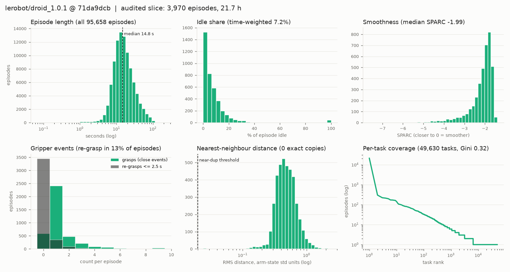

# Quality report: `lerobot/droid_1.0.1`

Revision `71da9dcba338f53889907ac5762a2ebc6c2e55ff` · license apache-2.0 (HF tag) · in-the-wild teleop (Franka, many labs) · Franka · 15 fps · LeRobot v3.0. Full dataset 95,658 episodes / 511.7 h; audited slice 3,970 episodes / 21.7 h from 4 data file(s). Lengths, labels and coverage use the full metadata; motion metrics use the slice.

| Metric | Value |
|-|-|
| Episode length, median (p5-p95) | 14.8 s (5.9-49.2); CV 0.78; 382 under 1 s |
| Idle time (still >= 0.5 s), time-weighted | 7.2% (lead 0.5 s, trail 0.0 s median; 1.59 mid-episode pauses/min) |
| End-effector < 1 cm/s (physical cross-check) | 15.3% |
| Smoothness: SPARC / state jerk / action jerk (median) | -1.99 / 0.108 / 0.344 |
| Grasps per episode (median), per minute | 1, 4.30 |
| Episodes with a re-grasp (retry) | 12.8% (0.20 per episode) |
| Gripper command/state sign agreement (median corr) | 1.00; negative in 0.0% |
| Exact / near-duplicate copies in slice | 0 / 0 |
| Exact copies, full dataset (meta stats scan) | 96 (0.1% of episodes) |
| Integrity faults (gaps / non-monotonic / frame_index / NaN / meta length) | 0 / 0 / 0 / 0 / 0 |
| Failed episodes (dataset success flag) | 17.5% |
| Task strings: total / empty / whitespace / dup groups / near-dup groups / typo words | 49,630 / 1 / 293 / 1090 / 216 / 49 |
| Episodes with an empty task | 21.9% |
| Coverage: tasks, effective tasks, Gini, tasks < 5 episodes | 49,629, 28,885.2, 0.32, 48,222 |
| **Usable hours (slice)** | **14.44 of 21.70 h = 66.6%** (strict, no re-grasp episodes: 54.4%) |
| Usable hours, full dataset (extrapolated) | 340.6 of 511.7 h |

Raw time lost, by first failing reason: integrity 0.0%, failed_episode 15.4%, empty_task_label 13.8%, duplicate 0.0%, too_short 0.0%, idle_time 4.2%.

Label hygiene examples: typo candidates `abcde`->`abide`, `armest`->`arrest`, `bandaids`->`bandaid`, `bedsheet`->`bedsheets`, `botte`->`bottle`, `bule`->`blue`; near-duplicate tasks `close the open drawer` / `close the open drawers` / `close the opened drawer`; `move the pillow to the right` / `move the pillows to the right`; `close the open upper cabinet door` / `close the open upper cabinet doors`; whitespace e.g. `'Remove all the paper trash from the table and put them in the bin  on the left'`.

Acceptance gate (shared thresholds, `specs/droid.json`): 9/14 checks pass. Failing: `dynamic_continuity` (13 episodes); `task_labels_clean` (897 episodes); `task_min_episodes` (2291 episodes); `idle_fraction` (227 episodes); `episode_length` (31 episodes).

Notes and findings:
- meta/episodes points to 86 of 156 data files on the Hub; 70 files (5.4 GB, file-086 to file-155) are unreferenced. Sampled orphan file-154 reuses episode ids 94870+ with lengths that disagree with meta in 606/607 episodes. The audit skips unreferenced files.
- Episodes 80912 and 95021 are byte-identical (same instruction, building and collector); the meta-stats scan finds 96 copies in all.
- Column `date` equals `collector_id` in 100% of sampled episodes, and `task_category` holds the lab name (Gates, TRI, BWW): these metadata columns look shifted.

Definitions: idle = every arm dimension below 5% of its p95 speed and gripper still, for >= 0.5 s, on a common 10 Hz grid. Re-grasp = gripper re-closes within 2.5 s of opening. SPARC on sub-movements split at idle runs and gripper events. Usable = episodes passing integrity, success (if labelled), non-empty task, not a duplicate copy, minus idle time.