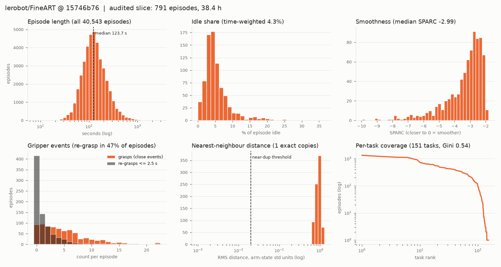

# Quality report: `lerobot/FineART`

Revision `15746b76ddc21ffd38d73888fefe2e7a1496385b` · license cc-by-4.0 (HF tag) · lab teleop (bimanual ALOHA-style) · aloha · 30 fps · LeRobot v3.0. Full dataset 40,543 episodes / 1,717.9 h; audited slice 791 episodes / 38.4 h from 5 data file(s). Lengths, labels and coverage use the full metadata; motion metrics use the slice.

| Metric | Value |
|-|-|
| Episode length, median (p5-p95) | 123.7 s (54.1-337.1); CV 0.75; 0 under 1 s |
| Idle time (still >= 0.5 s), time-weighted | 4.3% (lead 2.3 s, trail 3.0 s median; 0.64 mid-episode pauses/min) |
| End-effector < 1 cm/s (physical cross-check) | n/a |
| Smoothness: SPARC / state jerk / action jerk (median) | -2.99 / 0.279 / 0.253 |
| Grasps per episode (median), per minute | 4, 1.76 |
| Episodes with a re-grasp (retry) | 47.4% (1.44 per episode) |
| Gripper command/state sign agreement (median corr) | 0.96; negative in 0.0% |
| Exact / near-duplicate copies in slice | 1 / 0 |
| Exact copies, full dataset (meta stats scan) | 519 (1.3% of episodes) |
| Integrity faults (gaps / non-monotonic / frame_index / NaN / meta length) | 0 / 0 / 0 / 0 / 0 |
| Failed episodes (dataset success flag) | not labelled |
| Task strings: total / empty / whitespace / dup groups / near-dup groups / typo words | 151 / 0 / 0 / 0 / 1 / 6 |
| Episodes with an empty task | 0.0% |
| Coverage: tasks, effective tasks, Gini, tasks < 5 episodes | 151, 90.3, 0.54, 21 |
| **Usable hours (slice)** | **36.67 of 38.36 h = 95.6%** (strict, no re-grasp episodes: 43.6%) |
| Usable hours, full dataset (extrapolated) | 1,641.9 of 1,717.9 h |

Raw time lost, by first failing reason: integrity 0.0%, failed_episode 0.0%, empty_task_label 0.0%, duplicate 0.2%, too_short 0.0%, idle_time 4.3%.

Label hygiene examples: typo candidates `prefit`->`profit`, `relplace`->`replace`, `stevia`->`stevie`, `truvia`->`trivia`, `unhang`->`unhand`, `vace`->`face`; near-duplicate tasks `coil cords` / `coiling cords`.

Acceptance gate (shared thresholds, `specs/fineart.json`): 9/15 checks pass. Failing: `task_labels_clean` (0 episodes); `task_min_episodes` (5 episodes); `no_exact_duplicates` (1 episodes); `task_trajectory_consistency` (161 episodes); `idle_fraction` (5 episodes); `episode_length` (11 episodes).

Notes and findings:
- Dims 5/12 are named *_gripper but span about -1.8..0.9 and behave like a rotary wrist joint; dims 6/13 (*_gripper_finger, 0..0.04) behave like finger opening. The audit treats 6/13 as the grippers.
- Episodes 30424 and 30449 (task 88) are byte-identical in action and state; the meta-stats scan finds 519 such copies across the full dataset.
- The publisher's own motion scan (`meta/sampling/sampling_report.json`) strips 3.1% of frames as idle (chunk mode, threshold 0.002 rad/frame), the same order as this audit's idle share.

Definitions: idle = every arm dimension below 5% of its p95 speed and gripper still, for >= 0.5 s, on a common 10 Hz grid. Re-grasp = gripper re-closes within 2.5 s of opening. SPARC on sub-movements split at idle runs and gripper events. Usable = episodes passing integrity, success (if labelled), non-empty task, not a duplicate copy, minus idle time.