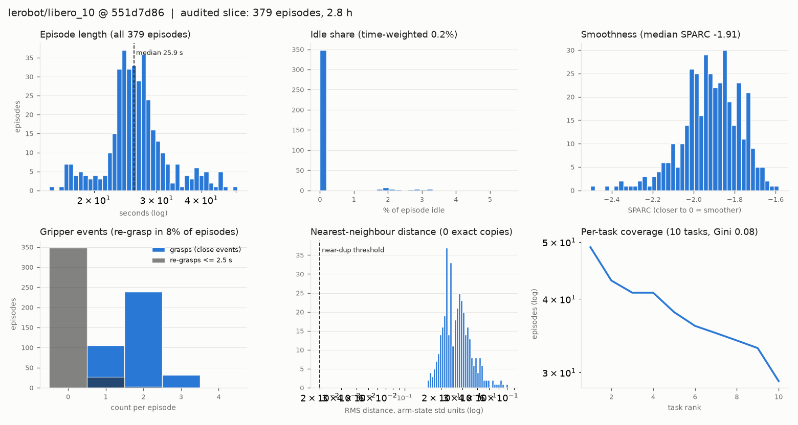

# Quality report: `lerobot/libero_10`

Revision `551d7d86f25edd0ffeda8b60053c15438cfd1d6a` · license apache-2.0 (HF tag) · sim (human teleop demos, LIBERO) · panda · 10 fps · LeRobot v3.0. Full dataset 379 episodes / 2.8 h; audited slice 379 episodes / 2.8 h from 147 data file(s). Lengths, labels and coverage use the full metadata; motion metrics use the slice.

| Metric | Value |
|-|-|
| Episode length, median (p5-p95) | 25.9 s (18.0-39.2); CV 0.21; 0 under 1 s |
| Idle time (still >= 0.5 s), time-weighted | 0.2% (lead 0.0 s, trail 0.0 s median; 0.05 mid-episode pauses/min) |
| End-effector < 1 cm/s (physical cross-check) | 8.0% |
| Smoothness: SPARC / state jerk / action jerk (median) | -1.91 / 0.047 / 0.049 |
| Grasps per episode (median), per minute | 2, 4.07 |
| Episodes with a re-grasp (retry) | 7.9% (0.09 per episode) |
| Gripper command/state sign agreement (median corr) | 0.91; negative in 0.0% |
| Exact / near-duplicate copies in slice | 0 / 0 |
| Exact copies, full dataset (meta stats scan) | n/a (no per-episode stats in meta) |
| Integrity faults (gaps / non-monotonic / frame_index / NaN / meta length) | 0 / 0 / 0 / 0 / 0 |
| Failed episodes (dataset success flag) | not labelled |
| Task strings: total / empty / whitespace / dup groups / near-dup groups / typo words | 10 / 0 / 0 / 0 / 0 / 0 |
| Episodes with an empty task | 0.0% |
| Coverage: tasks, effective tasks, Gini, tasks < 5 episodes | 10, 9.9, 0.08, 0 |
| **Usable hours (slice)** | **2.81 of 2.82 h = 99.8%** (strict, no re-grasp episodes: 90.7%) |
| Usable hours, full dataset (extrapolated) | 2.8 of 2.8 h |

Raw time lost, by first failing reason: integrity 0.0%, failed_episode 0.0%, empty_task_label 0.0%, duplicate 0.0%, too_short 0.0%, idle_time 0.2%.

Acceptance gate (shared thresholds, `specs/libero_10.json`): 15/15 checks pass.

Notes and findings:
- info.json names state dims x,y,z,rx,ry,rz,rw,gripper; the values are xyz + axis-angle (3) + two finger joint positions (+0.039/-0.039 open). The names do not match the data.
- meta/episodes has no `tasks` column; per-episode tasks taken from data task_index.

Definitions: idle = every arm dimension below 5% of its p95 speed and gripper still, for >= 0.5 s, on a common 10 Hz grid. Re-grasp = gripper re-closes within 2.5 s of opening. SPARC on sub-movements split at idle runs and gripper events. Usable = episodes passing integrity, success (if labelled), non-empty task, not a duplicate copy, minus idle time.